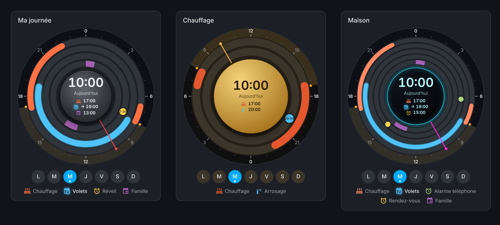
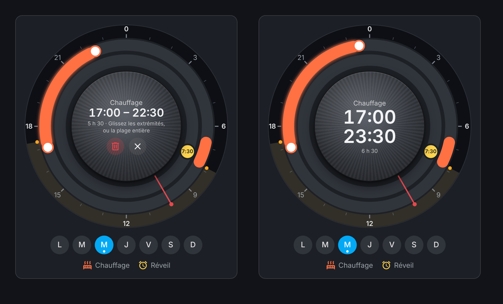
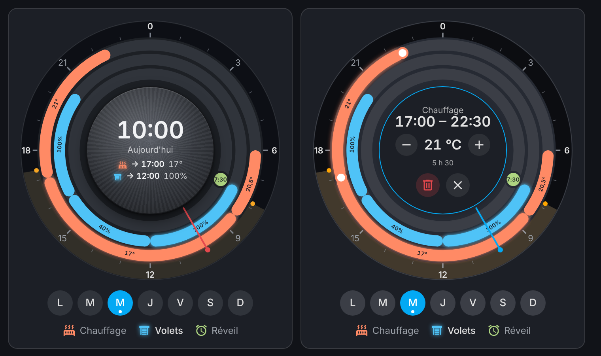
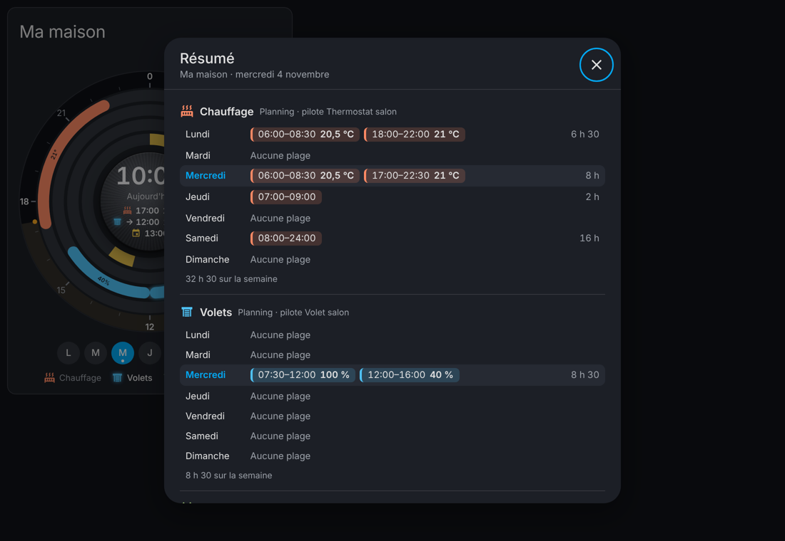
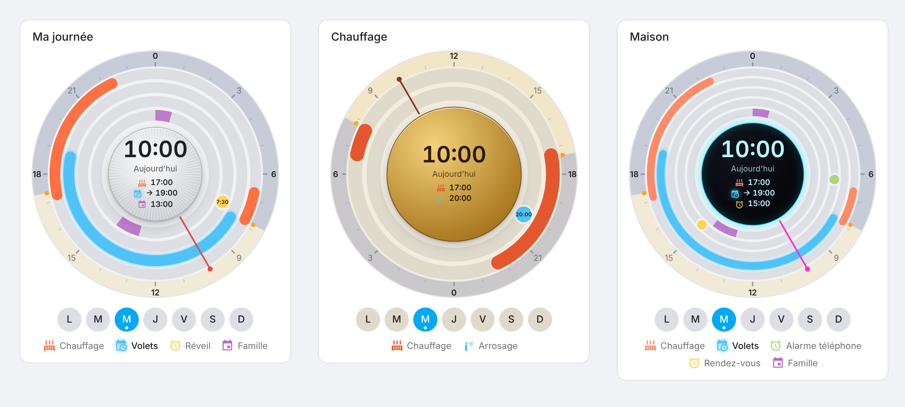
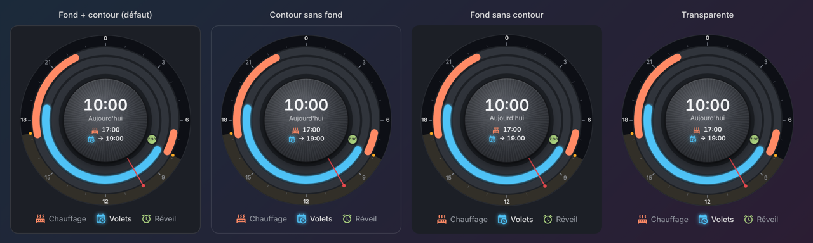
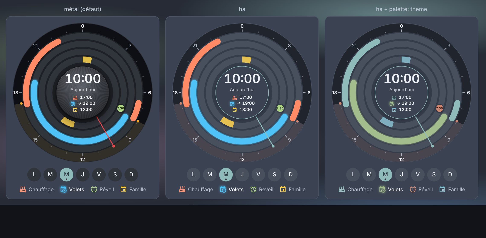
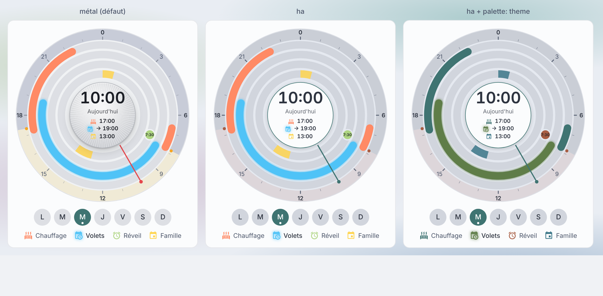

# Day Wheel Card

A 24-hour wheel for Home Assistant dashboards: your schedules, alarms, appointments and calendars on one dial, with night, sun and the current time. Schedule time ranges are edited **right on the dial**, and can control your thermostats, covers and lights.

*Roue des 24 heures pour les tableaux de bord Home Assistant : plannings, réveils, rendez-vous et calendriers sur un cadran, modifiables au doigt.*

**[English](#english)** · **[Français](#français)**

[](https://my.home-assistant.io/redirect/hacs_repository/?owner=benshoesweb&repository=day-wheel-card&category=plugin)
[](https://github.com/benshoesweb/day-wheel-card/actions/workflows/validate.yml)
[](https://github.com/benshoesweb/day-wheel-card/actions/workflows/tests.yml)



---

## English

The card and its visual editor follow Home Assistant's language (English or French).

### Features

- **1 to 6 rings**, one per entity, from the outside in:
  - **Schedule** (`schedule`, Home Assistant's "Schedule" helper): the day's time ranges, **edited with a finger or the mouse**;
  - **Time** (`input_datetime`, `time`): a marker (alarm, watering…) you drag;
  - **Timestamp** (`sensor` with the timestamp device class, e.g. the phone's next alarm): a marker;
  - **Calendar** (`calendar`): today's events.
- **Heating, covers, lights**: a schedule can control a thermostat, a cover or a light (or a light group); each time range has its own temperature, position or brightness, set with a finger. An [automation created by the card](#the-automation-is-created-for-you) applies it on time.
- **Days of the week**: view and edit any day's schedule.
- **Summary** on a long press of the center: every schedule's week with its values, the times, today's events and the card settings, in a window that follows the theme and fits phones, tablets and computers.
- **Night and sun**: the hour ring darkens from sunset to sunrise.
- **Current-time hand** and, in the center, what's on and what's next ("→ 19:00" = until 19:00).
- **Server time**: the dial follows Home Assistant's time zone, not the tablet's.
- **24-hour (default) or 12-hour time** (7:30 PM), or automatic, following each user's Home Assistant profile.
- **Live updates**: a schedule changed elsewhere is redrawn right away.
- **7 center styles** (metal, Home Assistant theme, glass, soft, brass, carbon, neon), noon or midnight at the top, **haptic feedback**, light or dark theme.
- **Follows the Home Assistant theme**: with the `ha` style, the whole dial (face, empty rings, ticks, day / night ring, center, hand) uses the active theme's colors, and `palette: theme` gives the rings the theme's colors. Theme changes apply instantly.
- **Card background** of your choice, transparent included, like in Radial Selector Card.
- **Full visual editor**.

### Editing a schedule



| Gesture | Effect |
|---|---|
| Drag the end of a range | changes the start or end time (adjustable step: 15 min by default) |
| Drag the middle of a range | moves it without changing its length |
| Long press an empty spot of the ring | new one-hour range |
| Tap a range | selects it: times and length in the center, trash icon to delete it (or the Delete key) |
| − / + in the center (range selected) | changes its temperature, position or brightness (schedule with `target`); also the up / down arrow keys |
| Drag a time marker | changes the time of the `input_datetime` or `time` |
| Days under the dial | show (and edit) that day's schedule |
| Long press the center | opens the **summary** (keyboard: Enter on the center) |
| Legend | opens the entity's more-info dialog |

Ranges never overlap and stop at midnight, as in Home Assistant's editor. A range's custom data (`data`) is kept. Editing is for **administrators** (Home Assistant rule); other users see the dial read only. Schedules defined in YAML can't be read by cards: create them under **Settings › Devices & services › Helpers › Schedule**.

### Controlling heating, covers and lights



Give a schedule ring a device to control (**Control** in the editor, `target` in YAML):

| Device | Value of each range | Default step |
|---|---|---|
| Thermostat (`climate`) | temperature | the thermostat's step and limits (usually 0.5°) |
| Cover (`cover`) | position, from 0 (closed) to 100 % (open) | 10 % |
| Light (`light`), light groups included | brightness | 10 to 100 %, by 10 % |

Select a range: its value shows in the center, between **−** and **+**. It is also written along the range, and the center shows it at rest ("→ 19:00 21°"). A new range takes its neighbour's value. `min`, `max` and `step` change the limits and the step.

```yaml
type: custom:day-wheel-card
layers:
  - entity: schedule.heating
    target: climate.living_room
  - entity: schedule.shutters
    target: cover.living_room
  - entity: schedule.lighting
    target: light.living_room_group
```

#### The automation is created for you

The card only runs while the dashboard is shown: for the devices to follow the schedule **at any time**, an automation on the server is needed. **The card creates it itself**, one per schedule, as soon as you set a first value on a range:

- it installs the [`day_wheel_schedule.yaml`](blueprints/day_wheel_schedule.yaml) blueprint if needed (one already imported is reused), creates the **"Day Wheel · Heating → Living room thermostat"** automation (schedule name → controlled device) and runs it once, so the current range applies right away;
- only one per schedule: it reads the schedule on every change, so adding, moving or deleting a range needs nothing more, from the card or from Home Assistant;
- no duplicates: if an automation already uses this schedule with the blueprint (made by hand, for example), the card uses it;
- the **summary** (long press on the center) and the **editor** (under "Control") show its state (active, turned off, missing) with the **Create the automation**, **Open** and, if you changed the controlled device, **Control …** buttons to update it;
- it is a regular automation: set its outside values or add devices under **Settings › Automations & scenes**.

Only an administrator can create an automation. With `create_automation: false` (checkbox in the editor), nothing is created on its own: use the button, or import the blueprint and create the automation yourself:

[](https://my.home-assistant.io/redirect/blueprint_import/?blueprint_url=https%3A%2F%2Fgithub.com%2Fbenshoesweb%2Fday-wheel-card%2Fblob%2Fmain%2Fblueprints%2Fday_wheel_schedule.yaml)

What the automation does:

- **During a range**: the range's value is sent (thermostat turned back on if it was off; a cover without position control: opened, or closed at 0 %). A range without a value uses the value set in the blueprint.
- **Outside the ranges**: your choice of an "outside" temperature or position (17° and 0 % by default), turning the thermostat or lights off, or nothing.
- A value changed on the current range applies right away; a manual adjustment stays until the next range. When Home Assistant restarts, everything is restored.
- **Several lights together**: create a light group (**Settings › Devices & services › Helpers › Create helper › Group › Light group**) and pick it as the device. The blueprint also accepts several devices for one schedule (for example all the thermostats upstairs).

The value is stored in the range's data (`temperature`, `position` or `brightness_pct`): Home Assistant shows it as a schedule attribute during the range, and your own automations can use it too. The blueprint needs Home Assistant 2024.10 or later.

### Summary



A **long press on the center** of the dial opens a window that recaps everything:

- for each schedule, **the 7 days** with their ranges and values (temperature, position, brightness), each day's length and the week's total; today is highlighted, and the controlled device and its automation are shown;
- the time of alarms and markers, the date of the next alarm, today's calendar events;
- the card settings (step, orientation, style, colors, theme), sunrise and sunset, and whether you can edit the schedules.

The window uses the **Home Assistant theme's** colors (or the light / dark theme chosen for the card) and updates live. When there is a lot to show, it **scrolls**. On a **phone** it takes the whole screen, like Home Assistant's dialogs; on a **tablet** or **computer** it shows in the center. To close it: the **cross** at the top right, the Escape key, or a click outside. `summary: false` turns the long press off.

### Installation

#### Marketplace (recommended)

The card is in the official HACS catalog, built into Home Assistant since 2026.11:

- **Home Assistant 2026.11 and later**: **Settings › Marketplace**, search for "Day Wheel Card", then **Download**.
- **Earlier versions, with HACS installed**: **HACS**, search for "Day Wheel Card", then **Download**.

The **Open in Home Assistant** button above leads straight to the card: in the **Marketplace** on Home Assistant 2026.11 and later, in **HACS** on earlier versions. The dashboard resource is added automatically, and new versions are offered as updates.

Compatibility: tested with Home Assistant 2026.11 (schedules, calendars, times, editor and blueprint). The blueprint needs Home Assistant 2024.10 or later.

#### Manual

1. Download `day-wheel-card.js` from the [latest release](https://github.com/benshoesweb/day-wheel-card/releases/latest).
2. Copy it to `/config/www/`.
3. **Settings › Dashboards › ⋮ › Resources**: add `/local/day-wheel-card.js` (JavaScript module).

### Configuration

Everything can be set in the visual editor. YAML example:

```yaml
type: custom:day-wheel-card
name: My day
knob_theme: metal
layers:
  - entity: schedule.heating
    color: "#ff7043"
  - entity: schedule.shutters
    color: "#4fc3f7"
  - entity: input_datetime.alarm
    icon: mdi:alarm
  - entity: calendar.family
```

| Option | Values | Default |
|---|---|---|
| `layers` | 1 to 6 rings: `entity`, `name` (otherwise the name Home Assistant displays), `color`, `icon` (or just the entity_id); for a schedule: `target` (thermostat, cover or light to control), `min`, `max`, `step` ([see above](#controlling-heating-covers-and-lights)) | — |
| `name` | card title, using Home Assistant's standard card title (it follows the theme: `--ha-card-header-font-size`, `--ha-card-header-color`…) | none |
| `orientation` | `midnight_top` (midnight at the top), `noon_top` (noon at the top) | `midnight_top` |
| `snap` | adjust step in minutes: `5`, `10`, `15`, `30`, `60` | `15` |
| `time_format` | `24` (19:30), `12` (7:30 PM, dial numbered 12a … 9p), `auto` (each user's **Time format** setting in their Home Assistant profile) | `24` |
| `show_sun` | day / night ring, sunrise and sunset | `true` |
| `show_days` | days of the week (with a schedule or a calendar) | `true` |
| `show_legend` | legend under the dial | `true` |
| `haptics` | haptic feedback under the finger | `true` |
| `summary` | summary on a long press of the center | `true` |
| `create_automation` | creates the automation of a controlled schedule as soon as a first value is set ([see above](#the-automation-is-created-for-you)) | `true` |
| `knob_theme` | `metal`, `ha` (whole dial in the theme's colors), `glass`, `neumorph`, `brass`, `carbon`, `neon` | `metal` |
| `palette` | colors of rings without a chosen color: `default` (card palette) or `theme` (theme colors: primary, success, warning, info, error, accent) | `default` |
| `theme` | `auto`, `light`, `dark` | `auto` |
| `card_style` | card background and border: `standard` (theme background + border), `border_only` (border, no background), `background_only` (background, no border), `transparent` (no background, no border) | `standard` |
| `card_background`, `card_border_color` | CSS colors of the background and border (`#1c1f26`, `rgb(…)`, `var(--primary-color)`…) | theme |



#### Card background

As in Radial Selector Card, choose the background and border in the editor (**Card appearance**): theme background + border (default), border only, background only or **transparent**, for example to place the dial straight on the dashboard background. The background and border colors can also be picked; without a chosen color, the Home Assistant theme's colors apply.



```yaml
type: custom:day-wheel-card
card_style: transparent
layers:
  - schedule.heating
```

#### Follow the Home Assistant theme

For the whole card to change with your theme, choose in the editor **Center style: Home Assistant theme**, **Colors of rings without a chosen color: Home Assistant theme colors** and **Theme: Auto (HA theme)**:

```yaml
type: custom:day-wheel-card
knob_theme: ha
palette: theme
layers:
  - schedule.heating
  - schedule.shutters
  - input_datetime.alarm
```

Example with a Nord theme, dark then light (from left to right: metal, `ha`, `ha` + `palette: theme`):




Colors picked by hand for a ring (`color`) still win.

#### With Radial Selector Card

The card goes well with [Radial Selector Card](https://github.com/benshoesweb/radial-selector-card) (same knob styles): one to control the lights, the other for the schedules.

### Development

```bash
npm ci
npx playwright install chromium
npm test          # 257 checks in Chrome: display, drag, create, delete, values, summary, automations, rights, editor…
```

The tests also run on GitHub on every change (**Tests** workflow). History: [CHANGELOG.md](CHANGELOG.md).

### Publishing a new version

1. Edit `dist/day-wheel-card.js` (after changing the blueprint, copy it into the card: `node scripts/sync-blueprint.js`) and describe the change in [CHANGELOG.md](CHANGELOG.md), in French and in English, under "Non publié" (unreleased).
2. Rename the "Non publié" section to the version number (and update `package.json`), then merge into `main`.
3. **Only then**, create the GitHub release `vX.Y.Z` on `main` (or `./scripts/release.sh vX.Y.Z`): the tag then contains the right CHANGELOG.

The **Release** workflow attaches the card file to the release; the Marketplace then offers it as an update.

---

## Français

La carte et son éditeur visuel suivent la langue de Home Assistant (français ou anglais).

### Fonctionnalités

- **1 à 6 anneaux**, un par entité, de l'extérieur vers l'intérieur :
  - **Planning** (`schedule`, l'aide « Planning » de Home Assistant) : les plages du jour, **modifiables au doigt ou à la souris** ;
  - **Heure** (`input_datetime`, `time`) : un repère (réveil, arrosage…) à faire glisser ;
  - **Horodatage** (`sensor` de type timestamp, ex. prochaine alarme du téléphone) : un repère ;
  - **Calendrier** (`calendar`) : les événements du jour.
- **Chauffage, volets, lumières** : un planning peut piloter un thermostat, un volet roulant ou une lumière (ou un groupe de lumières) ; chaque plage a sa température, sa position ou sa luminosité, réglée au doigt. Une [automatisation créée par la carte](#lautomatisation-est-créée-pour-vous) l'applique à l'heure dite.
- **Jours de la semaine** : consultez et modifiez le planning de n'importe quel jour.
- **Résumé** par appui long sur le centre : toute la semaine des plannings avec leurs valeurs, les heures, les événements du jour et les réglages de la carte, dans une fenêtre aux couleurs du thème, adaptée au téléphone, à la tablette et au PC.
- **Nuit et soleil** : la couronne des heures s'assombrit du coucher au lever du soleil.
- **Aiguille** de l'heure actuelle et, au centre, ce qui est en cours et ce qui arrive (« → 19:00 » = jusqu'à 19:00).
- **Heure du serveur** : le cadran suit le fuseau de Home Assistant, pas celui de la tablette.
- **Heure sur 24 heures (par défaut) ou 12 heures** (7:30 PM), ou automatique, selon le profil Home Assistant de chaque utilisateur.
- Mises à jour **en direct** : un planning modifié ailleurs se redessine aussitôt.
- **7 styles de centre** (métal, thème Home Assistant, verre, doux, laiton, carbone, néon), midi ou minuit en haut, **retour haptique**, thème clair ou sombre.
- **Suit le thème Home Assistant** : avec le style `ha`, tout le cadran (fond, anneaux vides, graduations, couronne jour / nuit, centre, aiguille) prend les couleurs du thème actif, et `palette: theme` donne aux anneaux les couleurs du thème. Le changement de thème est immédiat.
- **Fond de la carte** au choix, transparent compris, comme dans Radial Selector Card.
- **Éditeur visuel complet**.

### Modifier un planning


| Geste | Effet |
|---|---|
| Glisser une extrémité de plage | change l'heure de début ou de fin (pas réglable : 15 min par défaut) |
| Glisser le milieu d'une plage | la déplace sans changer sa durée |
| Appui long sur un vide de l'anneau | nouvelle plage d'une heure |
| Appui sur une plage | la choisit : heures et durée au centre, corbeille pour la supprimer (ou touche Suppr) |
| − / + au centre (plage choisie) | change sa température, sa position ou sa luminosité (planning avec `target`) ; aussi flèches haut / bas |
| Glisser un repère d'heure | change l'heure du `input_datetime` ou du `time` |
| Jours sous le cadran | affichent (et modifient) le planning de ce jour |
| Appui long sur le centre | ouvre le **résumé** (au clavier : Entrée sur le centre) |
| Légende | ouvre la fiche de l'entité |

Les plages ne se chevauchent jamais et s'arrêtent à minuit, comme dans l'éditeur de Home Assistant. Les données personnalisées d'une plage (`data`) sont conservées. La modification est réservée aux **administrateurs** (règle de Home Assistant) ; les autres utilisateurs voient le cadran en lecture seule. Les plannings définis en YAML ne sont pas lisibles par les cartes : créez-les depuis **Paramètres › Appareils et services › Entrées › Planning**.

### Piloter le chauffage, les volets et les lumières


Donnez à un anneau de planning un appareil à piloter (**Piloter** dans l'éditeur, `target` en YAML) :

| Appareil | Valeur de chaque plage | Réglage par défaut |
|---|---|---|
| Thermostat (`climate`) | température | pas et limites du thermostat (0,5° en général) |
| Volet roulant (`cover`) | position, de 0 (fermé) à 100 % (ouvert) | par 10 % |
| Lumière (`light`), groupe de lumières compris | luminosité | de 10 à 100 %, par 10 % |

Choisissez une plage : sa valeur s'affiche au centre, entre **−** et **+**. Elle est aussi écrite le long de la plage, et le centre l'indique au repos (« → 19:00 21° »). Une nouvelle plage reprend la valeur de sa voisine. `min`, `max` et `step` changent les limites et le pas.

```yaml
type: custom:day-wheel-card
layers:
  - entity: schedule.chauffage
    target: climate.salon
  - entity: schedule.volets
    target: cover.salon
  - entity: schedule.eclairage
    target: light.salon_groupe
```

#### L'automatisation est créée pour vous

La carte ne fonctionne que lorsque le tableau de bord est affiché : pour que les appareils suivent le planning **à toute heure**, il faut une automatisation sur le serveur. **La carte la crée elle-même**, une par planning, dès que vous réglez une première valeur sur une plage :

- elle installe au besoin le blueprint [`day_wheel_schedule.yaml`](blueprints/day_wheel_schedule.yaml) (celui déjà importé est réutilisé), puis crée l'automatisation **« Day Wheel · Chauffage → Thermostat salon »** (nom du planning → appareil piloté) et la lance une fois, pour que la plage en cours s'applique tout de suite ;
- une seule par planning : elle lit le planning à chaque changement, donc ajouter, déplacer ou supprimer une plage ne demande rien de plus, depuis la carte comme depuis Home Assistant ;
- jamais de doublon : si une automatisation utilise déjà ce planning avec le blueprint (faite à la main, par exemple), la carte s'en sert ;
- le **résumé** (appui long sur le centre) et l'**éditeur** (sous « Piloter ») indiquent son état (active, désactivée, absente) avec les boutons **Créer l'automatisation**, **Ouvrir** et, si vous avez changé l'appareil piloté, **Piloter …** pour la mettre à jour ;
- c'est une automatisation normale : réglez ses valeurs hors plages ou ajoutez des appareils dans **Paramètres › Automatisations et scènes**.

Seul un administrateur peut créer une automatisation. Avec `create_automation: false` (case dans l'éditeur), rien n'est créé tout seul : utilisez le bouton, ou importez le blueprint et créez l'automatisation vous-même :

[](https://my.home-assistant.io/redirect/blueprint_import/?blueprint_url=https%3A%2F%2Fgithub.com%2Fbenshoesweb%2Fday-wheel-card%2Fblob%2Fmain%2Fblueprints%2Fday_wheel_schedule.yaml)

Ce que fait l'automatisation :

- **Pendant une plage** : la valeur de la plage est envoyée (thermostat rallumé s'il était éteint ; volet sans réglage de position : ouvert, ou fermé à 0 %). Une plage sans valeur prend la valeur choisie dans le blueprint.
- **Hors des plages** : au choix, température ou position « hors plages » (17° et 0 % par défaut), extinction du thermostat ou des lumières, ou rien.
- Une valeur changée sur la plage en cours s'applique aussitôt ; un réglage fait à la main reste en place jusqu'à la plage suivante. Au redémarrage de Home Assistant, tout est rétabli.
- **Plusieurs lumières ensemble** : créez un groupe de lumières (**Paramètres › Appareils et services › Entrées › Créer une entrée › Groupe › Groupe de lumières**) et choisissez-le comme appareil. Le blueprint accepte aussi plusieurs appareils pour un même planning (par exemple tous les thermostats de l'étage).

La valeur est rangée dans les données de la plage (`temperature`, `position` ou `brightness_pct`) : Home Assistant l'affiche en attribut du planning pendant la plage, et vos propres automatisations peuvent aussi s'en servir. Le blueprint demande Home Assistant 2024.10 ou plus.

### Résumé


Un **appui long sur le centre** du cadran ouvre une fenêtre qui récapitule tout :

- pour chaque planning, **les 7 jours** avec leurs plages et leurs valeurs (température, position, luminosité), la durée de chaque jour et le total de la semaine ; aujourd'hui est mis en avant, et l'appareil piloté et son automatisation sont indiqués ;
- l'heure des réveils et repères, la date de la prochaine alarme, les événements du jour des calendriers ;
- les réglages de la carte (pas, orientation, style, couleurs, thème), le lever et le coucher du soleil, et si vous pouvez modifier les plannings.

La fenêtre prend les couleurs du **thème Home Assistant** (ou du thème clair / sombre choisi pour la carte) et se met à jour en direct. S'il y a beaucoup d'informations, elle **défile**. Sur un **téléphone**, elle occupe tout l'écran, comme les fenêtres de Home Assistant ; sur une **tablette** ou un **PC**, elle s'affiche au centre. Pour la fermer : la **croix** en haut à droite, la touche Échap, ou un clic à côté. Option `summary: false` pour désactiver l'appui long.

### Installation

#### Marketplace (recommandé)

La carte fait partie du catalogue officiel de HACS, intégré à Home Assistant depuis la version 2026.11 :

- **Home Assistant 2026.11 et plus** : **Paramètres › Marketplace**, cherchez « Day Wheel Card », puis **Télécharger**.
- **Versions précédentes, avec HACS installé** : **HACS**, cherchez « Day Wheel Card », puis **Télécharger**.

Le bouton **Open in Home Assistant** en haut de la page mène directement à la carte : dans la **Marketplace** avec Home Assistant 2026.11 et plus, dans **HACS** avec les versions précédentes. La ressource du tableau de bord est ajoutée automatiquement, et les nouvelles versions sont proposées en mise à jour.

Compatibilité : testée avec Home Assistant 2026.11 (plannings, calendriers, heures, éditeur et blueprint). Le blueprint demande Home Assistant 2024.10 ou plus.

#### Manuelle

1. Téléchargez `day-wheel-card.js` depuis la [dernière release](https://github.com/benshoesweb/day-wheel-card/releases/latest).
2. Copiez-le dans `/config/www/`.
3. **Paramètres › Tableaux de bord › ⋮ › Ressources** : ajoutez `/local/day-wheel-card.js` (module JavaScript).

### Configuration

Tout se règle dans l'éditeur visuel. Exemple en YAML :

```yaml
type: custom:day-wheel-card
name: Ma journée
knob_theme: metal
layers:
  - entity: schedule.chauffage
    color: "#ff7043"
  - entity: schedule.volets
    color: "#4fc3f7"
  - entity: input_datetime.reveil
    icon: mdi:alarm
  - entity: calendar.famille
```

| Option | Valeurs | Défaut |
|---|---|---|
| `layers` | 1 à 6 anneaux : `entity`, `name` (sinon le nom affiché par Home Assistant), `color`, `icon` (ou simplement l'entity_id) ; pour un planning : `target` (thermostat, volet ou lumière à piloter), `min`, `max`, `step` ([voir plus haut](#piloter-le-chauffage-les-volets-et-les-lumières)) | — |
| `name` | titre de la carte, avec le titre standard des cartes Home Assistant (il suit le thème : `--ha-card-header-font-size`, `--ha-card-header-color`…) | aucun |
| `orientation` | `midnight_top` (minuit en haut), `noon_top` (midi en haut) | `midnight_top` |
| `snap` | pas de réglage en minutes : `5`, `10`, `15`, `30`, `60` | `15` |
| `time_format` | `24` (19:30), `12` (7:30 PM, cadran numéroté 12a … 9p), `auto` (réglage **Format de l'heure** du profil Home Assistant de chaque utilisateur) | `24` |
| `show_sun` | couronne jour / nuit, lever et coucher du soleil | `true` |
| `show_days` | jours de la semaine (avec un planning ou un calendrier) | `true` |
| `show_legend` | légende sous le cadran | `true` |
| `haptics` | retour haptique au doigt | `true` |
| `summary` | résumé par appui long sur le centre | `true` |
| `create_automation` | crée l'automatisation d'un planning piloté dès la première valeur réglée ([voir plus haut](#lautomatisation-est-créée-pour-vous)) | `true` |
| `knob_theme` | `metal`, `ha` (tout le cadran aux couleurs du thème), `glass`, `neumorph`, `brass`, `carbon`, `neon` | `metal` |
| `palette` | couleurs des anneaux sans couleur choisie : `default` (palette de la carte) ou `theme` (couleurs du thème : principale, succès, avertissement, info, erreur, accent) | `default` |
| `theme` | `auto`, `light`, `dark` | `auto` |
| `card_style` | fond et contour de la carte : `standard` (fond + contour du thème), `border_only` (contour sans fond), `background_only` (fond sans contour), `transparent` (ni fond ni contour) | `standard` |
| `card_background`, `card_border_color` | couleurs CSS du fond et du contour (`#1c1f26`, `rgb(…)`, `var(--primary-color)`…) | thème |


#### Fond de la carte

Comme pour Radial Selector Card, choisissez dans l'éditeur (**Apparence de la carte**) le fond et le contour : fond + contour du thème (par défaut), contour seul, fond seul ou **transparente**, par exemple pour poser le cadran directement sur le fond du tableau de bord. Les couleurs du fond et du contour peuvent aussi être choisies ; sans couleur choisie, celles du thème Home Assistant s'appliquent.


```yaml
type: custom:day-wheel-card
card_style: transparent
layers:
  - schedule.chauffage
```

#### Suivre le thème Home Assistant

Pour que toute la carte change avec votre thème, choisissez dans l'éditeur **Style du centre : Thème Home Assistant**, **Couleurs des anneaux sans couleur choisie : Couleurs du thème HA** et **Thème : Auto (thème HA)** :

```yaml
type: custom:day-wheel-card
knob_theme: ha
palette: theme
layers:
  - schedule.chauffage
  - schedule.volets
  - input_datetime.reveil
```

Exemple avec un thème Nord, en sombre puis en clair (de gauche à droite : métal, `ha`, `ha` + `palette: theme`) :


Les couleurs choisies à la main pour un anneau (`color`) restent prioritaires.

#### Avec Radial Selector Card

La carte va bien avec [Radial Selector Card](https://github.com/benshoesweb/radial-selector-card) (mêmes styles de bouton) : l'une pour piloter les lumières, l'autre pour les horaires.

### Développement

```bash
npm ci
npx playwright install chromium
npm test          # 257 vérifications dans Chrome : affichage, glisser, créer, supprimer, valeurs, résumé, automatisations, droits, éditeur…
```

Les tests tournent aussi sur GitHub à chaque modification (workflow **Tests**). Historique : [CHANGELOG.md](CHANGELOG.md).

### Publier une nouvelle version

1. Modifiez `dist/day-wheel-card.js` (après une modification du blueprint, recopiez-le dans la carte : `node scripts/sync-blueprint.js`) et notez le changement dans [CHANGELOG.md](CHANGELOG.md), en français et en anglais, sous « Non publié ».
2. Passez la section « Non publié » au numéro de version (et `package.json`), puis fusionnez dans `main`.
3. **Ensuite seulement**, créez la release GitHub `vX.Y.Z` sur `main` (ou `./scripts/release.sh vX.Y.Z`) : le tag contient alors le bon CHANGELOG.

Le workflow **Release** joint le fichier de la carte à la release ; la Marketplace la propose ensuite en mise à jour.
